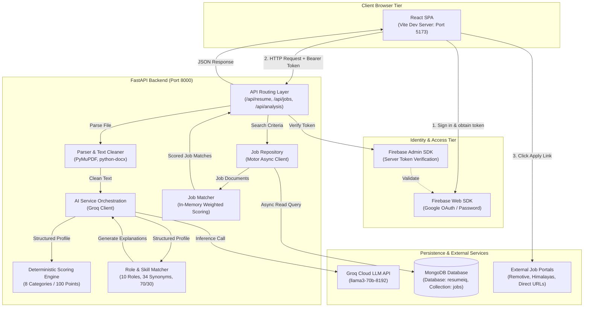
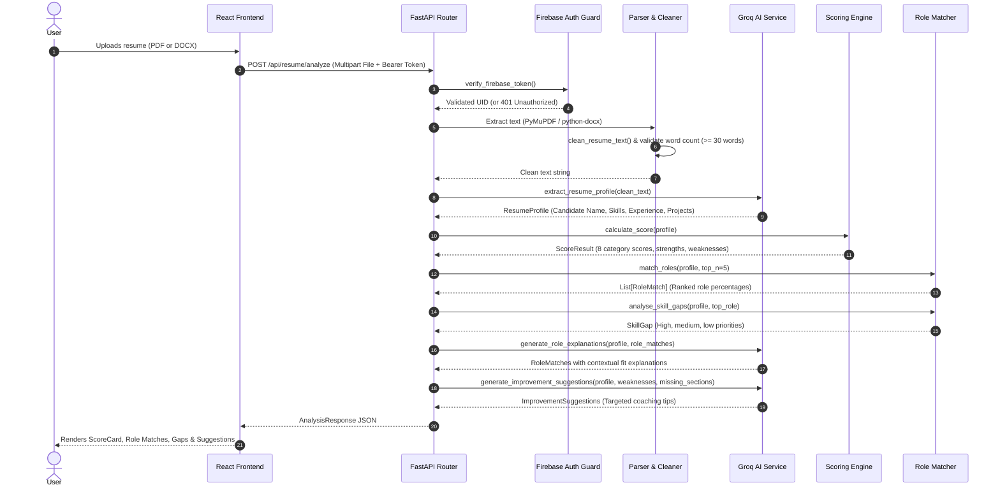
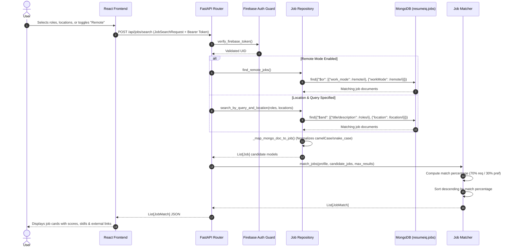

# ResumeIQ-py

**ResumeIQ-py** is the unified Python/FastAPI backend edition of the ResumeIQ platform. It preserves the established React user interface and product experience while replacing the legacy Java/Spring Boot + separate AI microservice backend with an asynchronous, monolithic Python backend architecture.

ResumeIQ bridges the gap between resume optimization and job discovery. It parses candidate resumes (PDF or DOCX), uses Groq-accelerated LLMs to extract structured profile information, runs deterministic multi-category scoring and role matching, and queries MongoDB for relevant job opportunities with direct application links.

---

## Table of Contents

- [⚡ Quick Start (One-Click Launchers)](#-quick-start-one-click-launchers)
- [Project Overview](#project-overview)
- [Key Features](#key-features)
- [Technology Stack](#technology-stack)
- [System Architecture](#system-architecture)
- [Core Workflows](#core-workflows)
  - [Resume Analysis Pipeline](#resume-analysis-pipeline)
  - [Job Discovery & Matching Pipeline](#job-discovery--matching-pipeline)
- [Backend Architecture](#backend-architecture)
- [Deterministic Scoring Engine](#deterministic-scoring-engine)
- [Role & Job Matching Methodology](#role--job-matching-methodology)
- [Authentication & Security](#authentication--security)
- [MongoDB Integration](#mongodb-integration)
- [API Reference](#api-reference)
- [Prerequisites & Installation](#prerequisites--installation)
- [Environment Configuration](#environment-configuration)
- [Running the Application](#running-the-application)
- [Testing & Quality Assurance](#testing--quality-assurance)
- [Troubleshooting](#troubleshooting)
- [Scope & Known Limitations](#scope--known-limitations)
- [Repository Structure](#repository-structure)
- [License & Acknowledgments](#license--acknowledgments)

---

## ⚡ Quick Start (One-Click Launchers)

ResumeIQ-py includes automated, cross-platform one-click startup scripts that resolve project directories, verify prerequisites, create the Python 3.12 virtual environment, install missing dependencies, check MongoDB availability, avoid port conflicts, poll service readiness, and launch the frontend in your default browser.

### 🍎 macOS
```bash
chmod +x start.sh
./start.sh
```
*To run without automatically launching the browser (e.g., in CI or headless testing), use `NO_BROWSER=1 ./start.sh`.*

### 🪟 Windows
- **File Explorer:** Double-click `start.bat`.
- **Command Prompt:**
```cmd
start.bat
```
*(On Windows, `start.bat` pauses on errors so diagnostic output remains visible if launched from File Explorer).*

---

### Prerequisites
Before launching ResumeIQ-py, ensure the following tools are installed:
- **Python 3.12** (verified compatible interpreter; Python 3.13+ is not supported due to Pydantic v1 / PyMuPDF bindings).
  - *macOS:* `brew install python@3.12`
  - *Windows:* Download from [python.org](https://www.python.org/downloads/) (ensure **"Add python.exe to PATH"** is selected).
- **Node.js (v18+) & npm**
  - *macOS:* `brew install node`
  - *Windows:* Download from [nodejs.org](https://nodejs.org/).
- **MongoDB** (Required for job discovery; optional for resume scoring and role matching).
  - *macOS:* `brew services start mongodb-community`
  - *Windows:* Ensure MongoDB Windows service is active on `127.0.0.1:27017`.

### First-Run Setup & Dependencies
The startup scripts automatically inspect and prepare the environment:
1. **Virtual Environment:** Automatically creates `backend/.venv` using the verified Python 3.12 interpreter if it does not already exist. Existing virtual environments are preserved and never deleted or overwritten.
2. **Backend Packages:** Verifies dependency imports via Python/pip check and installs packages from `backend/requirements.txt` only when missing. *(Note: First-run setup requires an active internet connection).*
3. **Frontend Packages:** Verifies `frontend/node_modules` and runs `npm ci` (or `npm install`) only when missing.
4. **Subsequent Launches:** Start instantaneously without reinstalling dependencies.

### Environment & Secret Configuration
The application requires user-provided credentials for external AI extraction and Firebase client authentication. The launchers verify configuration existence without printing or exposing secret values:
- **Backend Configuration:** Copy `backend/.env.example` to `backend/.env`:
  ```bash
  cp backend/.env.example backend/.env
  ```
  Configure `GROQ_API_KEY` (from [console.groq.com](https://console.groq.com/)), `FIREBASE_PROJECT_ID`, and `FIREBASE_CREDENTIALS_PATH`. *(Do not commit real credentials or service-account JSON files).*
- **Frontend Configuration:** Copy `frontend/.env.example` to `frontend/.env`:
  ```bash
  cp frontend/.env.example frontend/.env
  ```
  Configure your Firebase Web App credentials (`VITE_FIREBASE_*`) and confirm `VITE_API_BASE_URL=http://localhost:8000`.

### Service Access URLs
Once the HTTP readiness check passes, the application is accessible at:
- **Frontend Web UI:** [`http://localhost:5173`](http://localhost:5173)
- **FastAPI Backend:** [`http://127.0.0.1:8000`](http://127.0.0.1:8000)
- **Interactive Swagger Docs:** [`http://127.0.0.1:8000/docs`](http://127.0.0.1:8000/docs)
- **Alternative ReDoc:** [`http://127.0.0.1:8000/redoc`](http://127.0.0.1:8000/redoc)

### Graceful Shutdown
- **macOS (`start.sh`):** Press `Ctrl+C` in the terminal. The launcher traps `SIGINT`/`SIGTERM` and safely terminates only the child processes spawned by this session, freeing ports 8000 and 5173.
- **Windows (`start.bat`):** Close the dedicated "ResumeIQ - Backend" and "ResumeIQ - Frontend" command prompt windows, or press `Ctrl+C` inside them.

### Port Conflict Handling & Process Safety
The startup scripts enforce strict process safety rules:
- **Safe ResumeIQ Instance Reuse:** If port 8000 or 5173 is already listening and responds with the expected ResumeIQ signature (`{"status":"ok","service":"ResumeIQ Backend API"}` or HTTP 200 on frontend), the launcher reuses the healthy running service without launching duplicate processes.
- **Unrelated Process Protection:** If an occupied port belongs to an unrelated application, the script **never terminates or kills the foreign process**. It displays the conflicting process PID/name, logs an actionable error message, and safely exits.

---

## Project Overview

### The Problem
Job seekers frequently struggle with two distinct problems:
1. Understanding why their resumes fail automated applicant tracking systems (ATS) or initial recruiter screenings due to missing action verbs, poor formatting, or unquantified achievements.
2. Manually cross-referencing their specific technical skills against hundreds of job postings to identify genuine skill alignment.

### The Solution
ResumeIQ integrates both workflows into a single interface:
- **Comprehensive Resume Assessment:** Extracts candidate data, evaluates the document across eight deterministic categories, and provides targeted, actionable feedback.
- **Industry Role Alignment:** Evaluates candidate skills against a deterministic role catalogue to highlight strengths and high-priority skill gaps.
- **Targeted Job Matching:** Dynamically filters MongoDB-backed job postings and scores each opportunity against the candidate's verified skill profile.

---

## Key Features

- **Document Ingestion:** Extracts text from `.pdf` documents via PyMuPDF and `.docx` documents via `python-docx`.
- **Text Normalization:** Strips NULL bytes, collapses excessive whitespace, removes decorative noise characters, and enforces minimum content length.
- **AI-Powered Profile Extraction:** Converts unstructured resume text into a structured Pydantic schema using Groq LLM completions with automated JSON repair fallback.
- **Deterministic 100-Point Scoring:** Evaluates resumes across 8 categories without LLM hallucinations.
- **Deterministic Role Matching:** Compares candidate skills against 10 target roles using 34 technical skill aliases and a 70% required / 30% preferred weighting model.
- **Skill Gap Prioritization:** Categorizes missing technical proficiencies into high-, medium-, and low-priority gaps.
- **AI Improvement Coaching:** Generates role-fit explanations and actionable bullet-point recommendations tailored to identified weaknesses.
- **MongoDB-Backed Job Discovery:** Queries `resumeiq.jobs` with regex filters for title, description, location, and remote work modes.
- **Weighted Job Matching:** Ranks candidate opportunities by technical skill match percentage with external application links.
- **Stateless Firebase Authentication:** Secures sensitive endpoints with Bearer token validation using the Firebase Admin SDK.

---

## Technology Stack

| Layer | Technology | Purpose |
|---|---|---|
| **Frontend Framework** | React 18 + Vite | Single-page application providing the interactive user interface and state management. |
| **Styling & UI** | Vanilla CSS + Lucide Icons | Clean, responsive design system without heavy utility dependencies. |
| **Backend Framework** | FastAPI + Starlette | High-performance asynchronous web framework providing HTTP routing and OpenAPI schemas. |
| **ASGI Web Server** | Uvicorn | Lightweight production-ready ASGI web server running on port 8000. |
| **Data Validation** | Pydantic v2 + Pydantic Settings | Strict type enforcement, schema definitions, and environment variable configuration. |
| **AI / LLM Provider** | Groq Cloud SDK (`llama3-70b-8192`) | Ultra-low latency inference for resume profile extraction and contextual suggestions. |
| **Authentication** | Firebase Auth & Firebase Admin SDK | Client-side OAuth/password login and backend Bearer token verification. |
| **Document Processing** | PyMuPDF (`fitz`) & `python-docx` | Fast, reliable binary parsing for PDF and Microsoft Word resumes. |
| **Database & ODM** | MongoDB + Motor AsyncIO | Scalable document database hosting job listings with async Motor driver access. |
| **Testing** | pytest + anyio | Unit, integration, and security regression testing suite. |

---

## System Architecture

The following diagram illustrates the interaction between client browser components, backend services, external APIs, and the database persistence tier:



---

## Core Workflows

### Resume Analysis Pipeline

The resume analysis flow executes a sequential multi-stage pipeline:



### Job Discovery & Matching Pipeline

Job discovery matches candidates against pre-populated MongoDB opportunities without performing blocking external network crawls:



---

## Backend Architecture

The Python backend is organized into modular layers following clean architecture principles:

```text
backend/app/
├── main.py                 # Application bootstrap, CORS middleware, route registration
├── config.py               # Pydantic Settings configuration loader (.env)
├── api/                    # HTTP route controllers
│   ├── resume.py           # POST /api/resume/analyze (file upload & pipeline)
│   ├── jobs.py             # POST /api/jobs/search (job discovery)
│   └── roles.py            # GET /api/analysis/roles (catalogue discovery)
├── dependencies/
│   └── firebase_auth.py    # FastAPI Security dependency for Firebase JWT verification
├── models/
│   └── schemas.py          # Strict Pydantic v2 schemas and response models
├── parsers/
│   ├── pdf_parser.py       # PyMuPDF binary PDF extractor
│   ├── docx_parser.py      # python-docx document extractor
│   └── cleaner.py          # Regex whitespace and noise normalization
├── repositories/
│   └── job_repository.py   # Motor async MongoDB access and document mapper
└── services/
    ├── scoring_service.py  # Deterministic 8-category scoring engine
    ├── role_matching_service.py # Deterministic role and skill synonym matcher
    ├── job_matching_service.py  # In-memory candidate-to-job matching
    ├── groq_service.py     # Groq API client with JSON repair fallback
    └── analysis_service.py # End-to-end pipeline orchestrator
```

---

## Deterministic Scoring Engine

Resume scoring is completely deterministic, objective, and reproducible. It does not rely on LLM prompts for scoring calculations, preventing score variability between requests.

### Category Weight Distribution (100 Total Points)

| Category | Max Weight | Evaluation Criteria |
|---|:---:|---|
| **Skills** | 20 | Number of unique technical skills: 0 skills = 0 pts; 1–4 = 8 pts; 5–9 = 13 pts; 10–14 = 16 pts; 15+ = 20 pts. |
| **Experience** | 20 | Entry count: 1 entry = 10 pts; 2 = 14 pts; 3 = 17 pts; 4+ = 19 pts. Metric bonus: +1 pt if numbers/percentages are detected. |
| **Projects** | 15 | Count: 1 project = 7 pts; 2 = 10 pts; 3+ = 12 pts. Detail bonus: +3 pts if average length > 60 chars (+1.5 pts if > 30 chars). |
| **ATS Readiness** | 15 | Use of 28 ATS action verbs (max 6 pts), 39 tech keywords (max 5 pts), and quantified metric patterns `\b\d+\s*(%|x|k|\+)\b` (+4 pts). |
| **Education** | 10 | Presence and detail of education credentials: avg description length > 40 chars = 10 pts (<= 40 chars = 7 pts; missing = 0 pts). |
| **Structure** | 10 | Completeness of 6 standard sections: Summary, Education, Skills, Experience, Projects, Certifications (6+ sections = 10 pts; 5 = 9 pts; 4 = 7 pts; 3 = 5 pts; 2 = 3 pts; 1 = 1 pt). |
| **Certifications** | 5 | Credential count: 1 cert = 3 pts; 2 certs = 4 pts; 3+ certs = 5 pts. |
| **Achievements** | 5 | Highlighted achievements: 1 item = 3 pts; 2 items = 4 pts; 3+ items = 5 pts. |

All scores are rounded to one decimal place (`round(score, 1)`). Gaps between actual and maximum points are ranked descending to generate the top 5 improvement priorities.

---

## Role & Job Matching Methodology

### 1. The Role Catalogue
The engine matches candidate skills against 10 standard industry roles:
- **Software Engineer**, **Backend Developer**, **Java Developer**, **Python Developer**, **Full Stack Developer**, **Data Analyst**, **Data Engineer**, **Machine Learning Engineer**, **DevOps Engineer**, and **QA Engineer**.

### 2. Skill Normalization & Synonyms
Candidate skills are normalized by converting to lowercase, stripping trailing punctuation, and resolving against 34 synonym mappings (e.g., `k8s` -> `kubernetes`, `springboot` -> `spring boot`, `py` -> `python`, `postgres` -> `postgresql`, `amazon web services` -> `aws`). Skills are matched using whole-word regex boundaries to avoid substring false positives.

### 3. Weighted Formula
Both role matching and job matching apply a 70/30 weighting rule:
$$\text{Match Percentage} = \left(\frac{\text{Matched Required}}{\text{Total Required}} \times 0.70 + \frac{\text{Matched Preferred}}{\text{Total Preferred}} \times 0.30\right) \times 100$$

If preferred skills are not specified, required skill coverage accounts for the available score.

---

## Authentication & Security

1. **Client Token Issuance:** The React frontend uses the Firebase Web SDK to authenticate users via Google Popup or Email/Password, receiving an active Firebase ID token (JWT).
2. **Server-Side Token Guard:** Protected endpoints (`/api/resume/analyze` and `/api/jobs/search`) enforce token validation via `verify_firebase_token` in `app/dependencies/firebase_auth.py`.
3. **Fail-Closed Verification:**
   - Missing Authorization header -> **HTTP 401** (`Missing or invalid Authorization header`).
   - Invalid signature or malformed token -> **HTTP 401** (`Invalid authentication token`).
   - Expired token -> **HTTP 401** (`Invalid authentication token`).
4. **Credential Isolation:** Service account keys and local `.env` files are excluded from Git via `.gitignore`. The backend supports `FIREBASE_CREDENTIALS_PATH` for secure local initialization.

---

## MongoDB Integration

- **Database:** `resumeiq`
- **Collection:** `jobs`
- **Read-Only Access:** The repository operates exclusively using read-only `.find()` queries. It never executes `insert`, `update`, `delete`, or collection mutations.
- **Document Mapping:** Legacy documents with mixed camelCase/snake_case fields are normalized into typed Pydantic models:
  - `workMode` or `work_mode` -> `Job.work_mode`
  - `employmentType` or `employment_type` -> `Job.employment_type`
  - `jobUrl` or `job_url` -> `Job.job_url`
  - `skills` array -> `Job.required_skills`
  - Nested `salary` dict -> `Job.salary_min`, `Job.salary_max`, `Job.salary_currency`

---

## API Reference

### Compact Endpoint Matrix

| Method | Route | Auth | Payload | Response |
|---|---|:---:|---|---|
| `GET` | `/` | None | None | `{"status": "ok", "service": "ResumeIQ Backend API"}` |
| `GET` | `/api/analysis/roles` | None | None | `List[RoleCatalogueItem]` |
| `POST` | `/api/resume/analyze` | Bearer JWT | `multipart/form-data` (`file`) | `AnalysisResponse` (Score, Profile, Roles, Suggestions) |
| `POST` | `/api/jobs/search` | Bearer JWT | `application/json` (`JobSearchRequest`) | `List[JobMatch]` (Ranked jobs with match %) |

Detailed request schemas, sample responses, and error codes are documented in [docs/API.md](file:///Users/hariprasathc/Projects/resumeIQ-py/docs/API.md).

---

## Prerequisites & Installation

### System Requirements
- **Python 3.12.x** (Homebrew or pyenv)
- **Node.js 18.x or 20.x** & **npm**
- **MongoDB 7.x or 8.x** running locally on port 27017

### 1. Backend Installation

```bash
cd backend

# Create virtual environment explicitly using Python 3.12
python3.12 -m venv .venv
source .venv/bin/activate

# Upgrade pip and install pinned dependencies
python -m pip install --upgrade pip
pip install -r requirements.txt

# Verify dependency health
python -m pip check
```

### 2. Frontend Installation

```bash
cd frontend

# Install dependencies using npm
npm install
```

---

## Environment Configuration

### Backend Configuration (`backend/.env`)

Copy `backend/.env.example` to `backend/.env`:

```bash
cp backend/.env.example backend/.env
```

| Variable | Required | Description | Example |
|---|:---:|---|---|
| `GROQ_API_KEY` | **Yes** | API key from Groq Cloud console | `gsk_exampleKey123` |
| `GROQ_MODEL` | No | Target Groq LLM model identifier | `llama3-70b-8192` |
| `MONGODB_URI` | **Yes** | MongoDB connection string | `mongodb://localhost:27017/` |
| `FIREBASE_PROJECT_ID` | **Yes** | Firebase project identifier | `resumeiq-08` |
| `FIREBASE_CREDENTIALS_PATH` | Optional | Relative or absolute path to service account JSON | `secrets/firebase-service-account.json` |
| `FRONTEND_URL` | No | CORS allowed frontend origin | `http://localhost:5173` |

### Frontend Configuration (`frontend/.env`)

Copy `frontend/.env.example` to `frontend/.env`:

```bash
cp frontend/.env.example frontend/.env
```

| Variable | Required | Description | Example |
|---|:---:|---|---|
| `VITE_FIREBASE_API_KEY` | **Yes** | Firebase client Web API key | `AIzaSyExampleKey` |
| `VITE_FIREBASE_AUTH_DOMAIN` | **Yes** | Firebase authentication domain | `resumeiq.firebaseapp.com` |
| `VITE_FIREBASE_PROJECT_ID` | **Yes** | Firebase project ID | `resumeiq-08` |
| `VITE_FIREBASE_STORAGE_BUCKET`| No | Firebase storage bucket | `resumeiq.appspot.com` |
| `VITE_FIREBASE_MESSAGING_SENDER_ID`| No | Firebase sender ID | `1234567890` |
| `VITE_FIREBASE_APP_ID` | **Yes** | Firebase web application ID | `1:12345:web:abcdef` |
| `VITE_API_BASE_URL` | **Yes** | FastAPI backend target URL | `http://localhost:8000` |

---

## Running the Application

### Option A: One-Click Startup Script (Recommended)

Start the full stack with automated environment checks and service readiness polling:

**macOS:**
```bash
chmod +x start.sh
./start.sh
```

**Windows:**
Double-click `start.bat` or run `start.bat` from Command Prompt.

*Both scripts automatically verify dependencies, start Uvicorn (FastAPI) on port 8000 and Vite on port 5173, verify service readiness over HTTP, and launch the frontend in your default browser.*

### Option B: Manual Startup (Separate Terminals)

If you prefer running backend and frontend independently for manual debugging:

#### Terminal 1: Backend (Port 8000)
```bash
cd backend
./.venv/bin/python -m uvicorn app.main:app --host 127.0.0.1 --port 8000 --reload
```
*Accessible at `http://127.0.0.1:8000`. Swagger documentation at `http://127.0.0.1:8000/docs`.*

#### Terminal 2: Frontend (Port 5173)
```bash
cd frontend
npm run dev
```
*Accessible at `http://localhost:5173`.*

---

## Testing & Quality Assurance

### Run Backend Tests (Python 3.12)
```bash
cd backend
PYTHONPATH=. ./.venv/bin/python -m pytest -v
```

The 20 automated tests cover:
- Text normalization, line cleaning, and null byte removal (`test_parsers.py`).
- 8-category scoring, baseline profile, and empty resume edge cases (`test_scoring.py`).
- Role matching, skill normalization, and skill gap priorities (`test_role_matching.py`).
- MongoDB document field mapping and weighted job matching (`test_jobs.py`).
- Firebase authentication token enforcement and 401 rejections (`test_auth.py`).

### Run Frontend Production Build
```bash
cd frontend
npm run build
```
Generates a minified, production-ready bundle in `frontend/dist/`.

---

## Troubleshooting

| Issue | Root Cause | Solution |
|---|---|---|
| **Port 8000 already in use** | An orphaned backend process is still bound to port 8000. | Identify with `lsof -i :8000` and terminate with `kill <PID>`. |
| **`pydantic-core` install error** | Environment running on unsupported Python (e.g., Python 3.14 alpha). | Recreate `.venv` explicitly using `python3.12 -m venv .venv`. |
| **HTTP 401 on analyze or search** | Missing or invalid Firebase ID token. | Ensure `VITE_FIREBASE_*` variables are set in `frontend/.env` and `FIREBASE_PROJECT_ID` is set in `backend/.env`. |
| **Empty job search results `[]`** | MongoDB is not running or database has no records. | Confirm MongoDB is running (`mongod`) and populated with records in `resumeiq.jobs`. |
| **Groq 429 Rate Limit** | Free Groq API tier exceeded. | Wait 60 seconds or switch `GROQ_MODEL` to another supported model in `backend/.env`. |

---

## Scope & Known Limitations

- **Educational & Prototype Scope:** This project was developed as a backend migration and portfolio reference. It is not an enterprise applicant tracking system.
- **Deterministic vs. Human Review:** Scoring algorithms provide structured heuristics based on industry patterns; a high score does not guarantee employment or recruiter selection.
- **Database Dependency:** The job discovery service reads pre-existing listings from MongoDB. It does not perform live web crawls or external API queries during runtime search requests.
- **Browser Automation Verification:** While the full end-to-end HTTP pipeline was verified with live Firebase tokens and MongoDB queries, automated headless browser tests were limited by container-level Playwright driver availability. Interactive UI verification should be performed in a desktop browser.

---

## Repository Structure

```text
ResumeIQ-py/
├── README.md                      # Comprehensive project guide
├── .gitignore                     # Repository-wide ignore rules
├── docs/                          # Specialized technical documentation
│   ├── ARCHITECTURE.md            # System design & sequence diagrams
│   ├── API.md                     # REST API reference & examples
│   └── DEVELOPMENT.md             # Developer setup & debugging guide
├── frontend/                      # React SPA
│   ├── src/                       # Components, pages, context, services
│   ├── public/                    # Static assets (icons, favicons)
│   ├── package.json               # Frontend dependencies
│   ├── vite.config.js             # Vite bundler configuration
│   └── .env.example               # Frontend environment template
└── backend/                       # FastAPI application
    ├── app/                       # Core application package
    ├── tests/                     # pytest regression suite
    ├── requirements.txt           # Python dependency manifest
    └── .env.example               # Backend environment template
```

---

## License & Acknowledgments

- **License:** No formal open-source license has been specified for this repository. All rights are reserved by the repository owner.
- **Original Project:** Based on the architecture and domain logic of the original Java/Spring Boot `ResumeIQ` project.
