# ResumeIQ-Python

ResumeIQ-Python is the complete, independently runnable Python edition of the original Java/Spring Boot based ResumeIQ platform. It provides a unified FastAPI backend that integrates AI-powered resume analysis with deterministic scoring, role matching, and MongoDB-backed job discovery.

## Architecture Diagram

```mermaid
graph TD
    UI[Frontend: React + Vite]
    BE[Backend: FastAPI Python]
    DB[(MongoDB: resumeiq)]
    AI[Groq API: llama3-70b]
    Auth[Firebase Auth]

    UI -->|REST / JWT| BE
    UI -->|Sign in / Token| Auth
    BE -->|Verify Token| Auth
    BE -->|LLM Prompts| AI
    BE -->|Query Jobs| DB
```


## Features
- **Resume Upload & Parsing**: Parses PDF and DOCX files.
- **AI Profile Extraction**: Extracts structured skills, experience, and projects using Groq.
- **Deterministic Scoring**: Evaluates the resume across 8 categories (Skills, Experience, ATS Readiness, etc.).
- **Role Matching**: Matches extracted skills against a predefined role catalog.
- **AI Improvement Suggestions**: Generates personalized tips for resume improvement.
- **MongoDB Job Discovery**: Searches a MongoDB collection for jobs matching the candidate's skills, location, and remote preferences, ranked by match percentage.
- **Secure Authentication**: Backend verification of Firebase ID tokens.

## Technology Stack
- **Frontend**: React, Vite
- **Backend**: Python 3.11+, FastAPI, Uvicorn, Pydantic
- **AI Integration**: Groq API (llama3-70b-8192)
- **Database**: MongoDB (motor, pymongo)
- **Authentication**: Firebase Authentication & Firebase Admin SDK
- **Resume Parsing**: PyMuPDF (`fitz`), `python-docx`

## Repository Structure
```
resumeIQ-py/
├── backend/
│   ├── app/
│   │   ├── api/             # FastAPI routers (resume, jobs, roles)
│   │   ├── dependencies/    # Auth, DB injectors
│   │   ├── models/          # Pydantic schemas
│   │   ├── parsers/         # PDF, DOCX parsers and text cleaner
│   │   ├── repositories/    # MongoDB data access
│   │   ├── services/        # Scoring, Role matching, Groq AI, Analysis Orchestration
│   │   ├── config.py        # Environment variables configuration
│   │   └── main.py          # FastAPI application entrypoint
│   ├── tests/               # pytest test suite
│   ├── .env.example
│   └── requirements.txt
├── frontend/                # React Vite application
└── README.md
```

## Setup and Environment Configuration
1. **Clone the repository.**
2. **Navigate to the backend directory:** `cd backend`
3. **Configure Environment Variables:**
   Copy `.env.example` to `.env` and fill in the values:
   ```env
   GROQ_API_KEY=your_groq_api_key
   GROQ_MODEL=llama3-70b-8192
   MONGODB_URI=mongodb://localhost:27017/
   FIREBASE_PROJECT_ID=your_firebase_project_id
   FRONTEND_URL=http://localhost:5173
   ```
4. Ensure MongoDB is running locally or provide a remote MongoDB URI.

## How to Start
### Start the Backend
```bash
cd backend
python3 -m venv .venv
source .venv/bin/activate
pip install -r requirements.txt
uvicorn app.main:app --reload --port 8000
```
*Note: The backend defaults to port 8000.*

### Start the Frontend
```bash
cd frontend
npm install
npm run dev
```
*Note: The frontend defaults to port 5173.*

## API Endpoints
- `GET /` - Health check
- `POST /api/resume/analyze` - Uploads a PDF/DOCX and returns full analysis (`multipart/form-data`)
- `POST /api/jobs/search` - Searches for matching jobs (`application/json`)
- `GET /api/analysis/roles` - Fetches the deterministic role catalog

Full OpenAPI documentation is available at `http://localhost:8000/docs` when the backend is running.

## Authentication and Security
The platform uses Firebase Authentication. The React frontend handles user sign-in and obtains a Firebase ID token. This token is sent to the backend in the `Authorization: Bearer <token>` header. The FastAPI backend uses the Firebase Admin SDK to verify the token signature and expiration before allowing access to protected endpoints (`/api/resume/analyze`, `/api/jobs/search`).

## MongoDB Integration
Job discovery relies on a pre-populated MongoDB database named `resumeiq` with a collection named `jobs`. The API queries this collection using regex on `title`, `description`, `location`, and `work_mode`, then performs skill matching in-memory for the filtered candidates. The original job documents are safely preserved and only read.

## Testing
To run the automated tests for the backend logic (parsers, scoring, role matching):
```bash
cd backend
source .venv/bin/activate
PYTHONPATH=. pytest tests/
```

## Troubleshooting
- **Missing Firebase Credentials Error:** If `GOOGLE_APPLICATION_CREDENTIALS` is not set, Firebase Admin might fail to verify tokens. Ensure you have the proper credentials or mock the auth in local development.
- **Groq API Rate Limits:** The Groq API is fast but has strict rate limits. If you receive `503` or `429` errors, check your Groq console.
- **MongoDB Connection:** Ensure `MONGODB_URI` accurately points to the running instance and the `resumeiq` database contains the jobs collection.

## Current Limitations
- External Job integrations depend on pre-populated MongoDB data; live fetching via third-party providers (like Adzuna) is not fully bridged in this Python edition and instead focuses exclusively on the Mongo cache.
- The Python virtual environment setup requires Python 3.11+.
