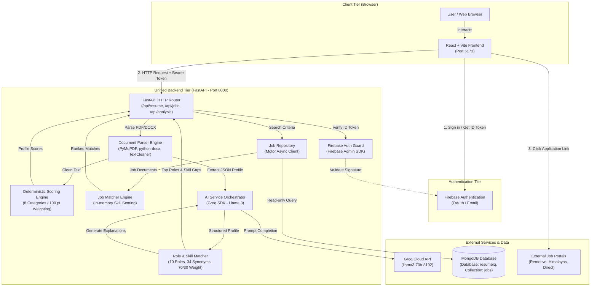
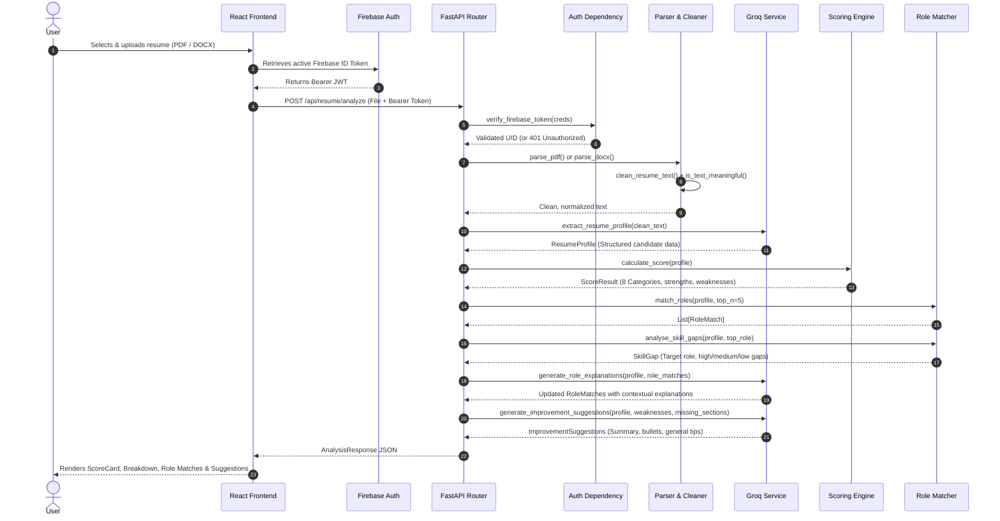
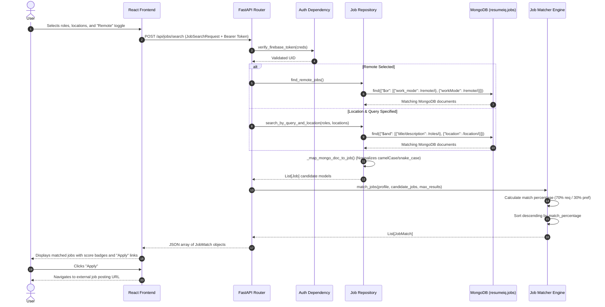
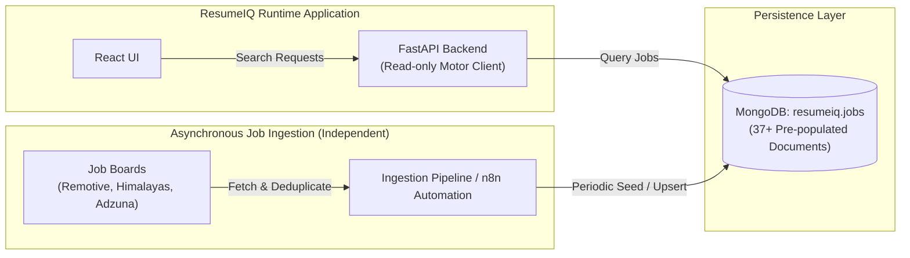

# System Architecture & Technical Design

## 1. Architectural Overview

ResumeIQ-py is a language and architecture migration of the original ResumeIQ platform. The original design relied on a Java 21 / Spring Boot primary backend (port 8080) communicating via HTTP with a separate Python FastAPI AI microservice (port 8000), alongside a React SPA (port 5173), Firebase Authentication, Groq LLM API, and MongoDB.

In **ResumeIQ-py**, the backend responsibilities have been unified into a single, high-performance, asynchronous Python / FastAPI application running on port 8000. The Python backend natively handles document ingestion, deterministic scoring, role matching, AI orchestration, database queries, and token verification, eliminating inter-service HTTP hops and simplifying runtime deployment.

---

## 2. Component Breakdown & Responsibilities

| Component | Module Path | Primary Responsibility |
|---|---|---|
| **API Entrypoint & Routers** | `app/main.py`, `app/api/` | Initializes FastAPI application, registers CORS middleware, and handles HTTP endpoints for resume upload, role discovery, and job search. |
| **Configuration** | `app/config.py` | Type-safe environment loading using Pydantic Settings (`pydantic-settings`). Loads `.env` values for Groq, MongoDB, Firebase, and CORS. |
| **Authentication Guard** | `app/dependencies/firebase_auth.py` | FastAPI `Security(HTTPBearer)` dependency. Verifies Firebase ID tokens via the Firebase Admin SDK. Rejects missing, invalid, or expired tokens with HTTP 401. |
| **Data Schemas & Models** | `app/models/schemas.py` | Strict Pydantic v2 data models for resume profiles, category scores, role matches, skill gaps, improvement suggestions, and job postings. |
| **Document Parsers** | `app/parsers/` | Extracts raw text from uploaded files: PyMuPDF for PDF (`pdf_parser.py`), `python-docx` for Word documents (`docx_parser.py`), and regex normalizer (`cleaner.py`). |
| **Scoring Engine** | `app/services/scoring_service.py` | Deterministic, non-AI calculation across 8 distinct categories totaling 100 points. Generates strengths, weaknesses, and prioritized improvement actions. |
| **Role Matching Engine** | `app/services/role_matching_service.py` | Deterministic matching against a 10-role industry catalogue. Applies 34 skill synonyms and weighted scoring (70% required / 30% preferred). |
| **Job Repository** | `app/repositories/job_repository.py` | Asynchronous Motor client querying MongoDB `resumeiq.jobs`. Maps legacy document structures into typed `Job` models without modifying database records. |
| **Job Matching Engine** | `app/services/job_matching_service.py` | Scores candidate technical skills against filtered MongoDB job opportunities, calculating match percentages and missing skills. |
| **AI Orchestrator** | `app/services/groq_service.py` | Interfaces with Groq API. Extracts structured resume profiles with automated JSON repair, produces concise role explanations, and generates targeted improvement tips. |
| **Analysis Pipeline** | `app/services/analysis_service.py` | Orchestrates the multi-stage resume analysis pipeline from text extraction to combined JSON response delivery. |

---

## 3. Resume Analysis Flow (Sequence Diagram)

When a user uploads a resume file (`.pdf` or `.docx`), the frontend attaches the active Firebase Bearer token and submits a `multipart/form-data` request to `POST /api/resume/analyze`.

---

## 4. Job Discovery Flow (Sequence Diagram)

Job discovery allows candidates to find live opportunities matched against their analyzed profile. The user selects search parameters (target roles, locations, remote preference) in the existing UI, which invokes `POST /api/jobs/search`.

---

## 5. Upstream Data Ingestion Architecture (Decoupled)

The runtime application operates exclusively as a **read-only consumer** of the `resumeiq.jobs` collection. Upstream data collection occurs asynchronously through external automated workflows (e.g., n8n webhooks or scraping jobs) that populate MongoDB independently.

---

## 6. Security Architecture

1. **Client-Side Authentication:** Handled via Firebase Web SDK in the React application (`frontend/src/firebase.js`). Google OAuth popup and email/password providers generate short-lived JWT ID tokens.
2. **Server-Side Token Verification:** Protected backend endpoints require an `Authorization: Bearer <id_token>` header. The `verify_firebase_token` FastAPI dependency passes this token to `firebase_admin.auth.verify_id_token()`, verifying:
   - Token signature against Google's public certificates.
   - Token issuer (`https://securetoken.google.com/<FIREBASE_PROJECT_ID>`).
   - Token expiration timestamp.
3. **Fail-Closed Security Posture:**
   - Missing Authorization header -> **HTTP 401** (`Missing or invalid Authorization header`).
   - Tampered / invalid token -> **HTTP 401** (`Invalid authentication token`).
   - Expired token -> **HTTP 401** (`Invalid authentication token`).
   - No bypasses or fallback mock tokens are permitted in production code paths.
4. **Credential Isolation:** Service account private keys (`secrets/firebase-service-account.json`) and API keys (`.env`) are strictly excluded from version control via `.gitignore`.
